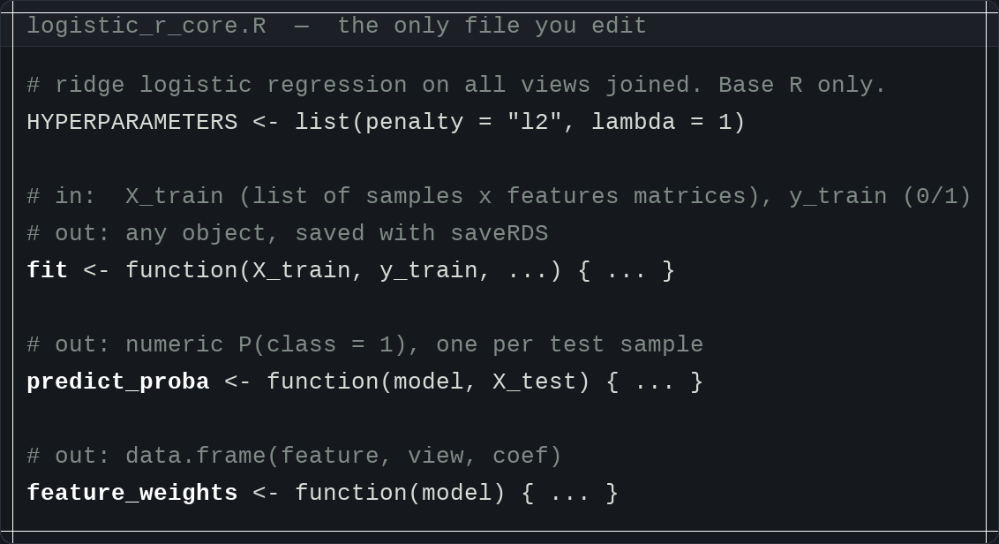
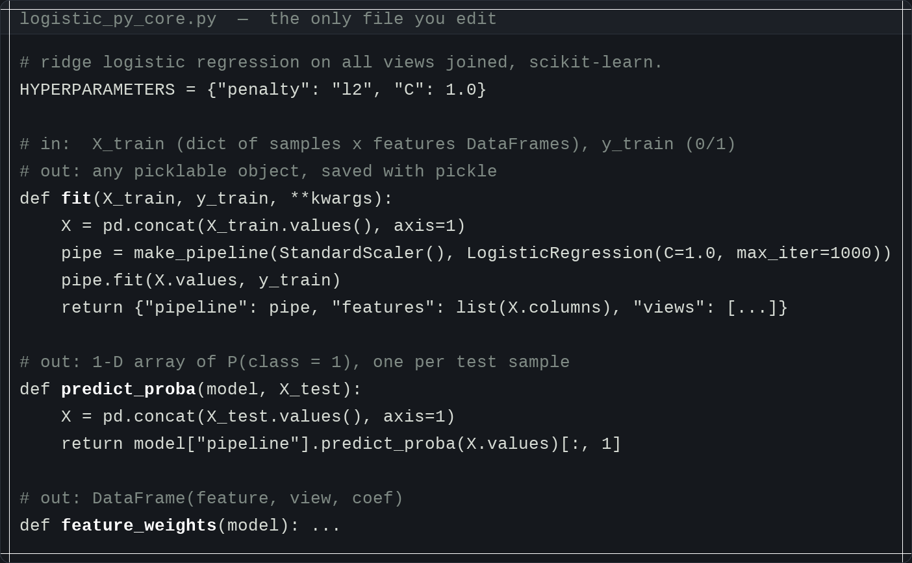
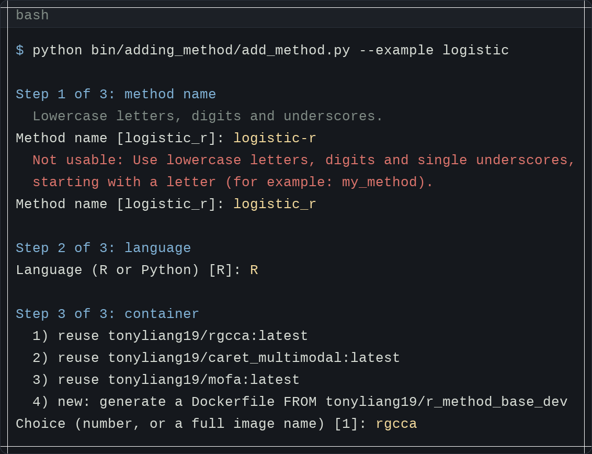
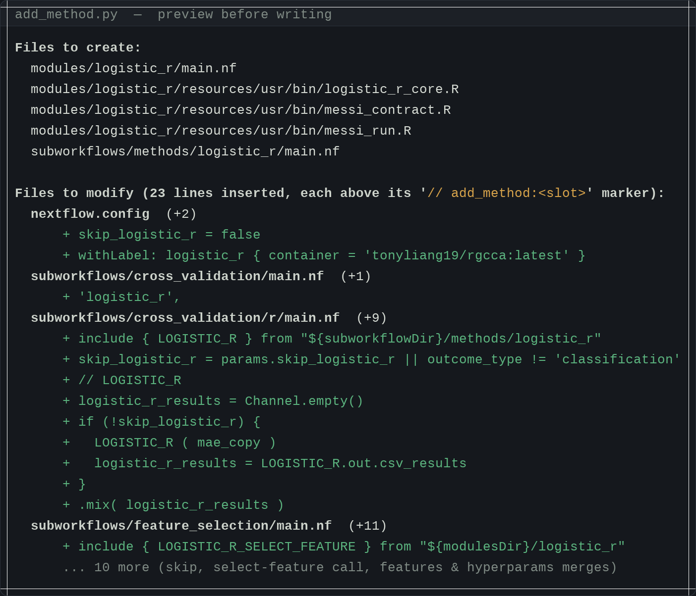
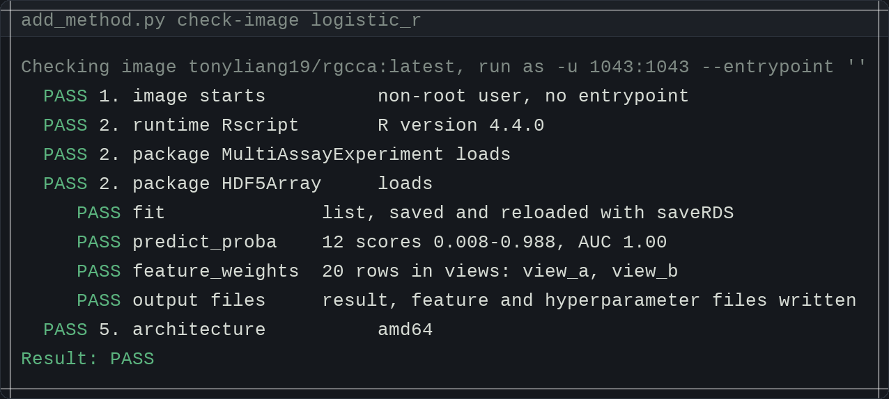
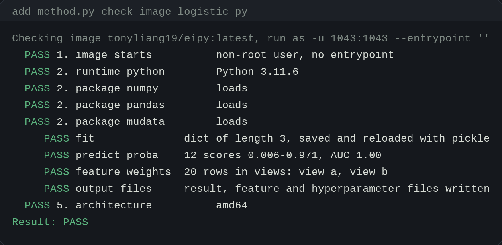
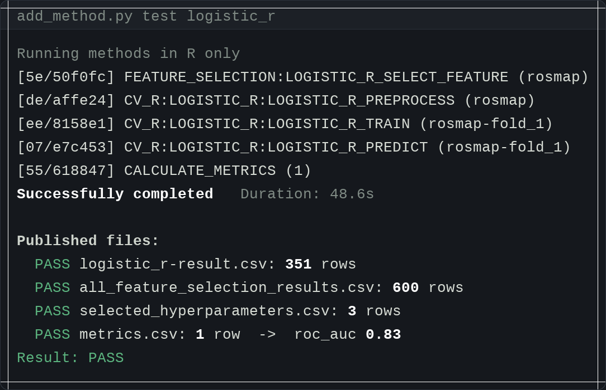
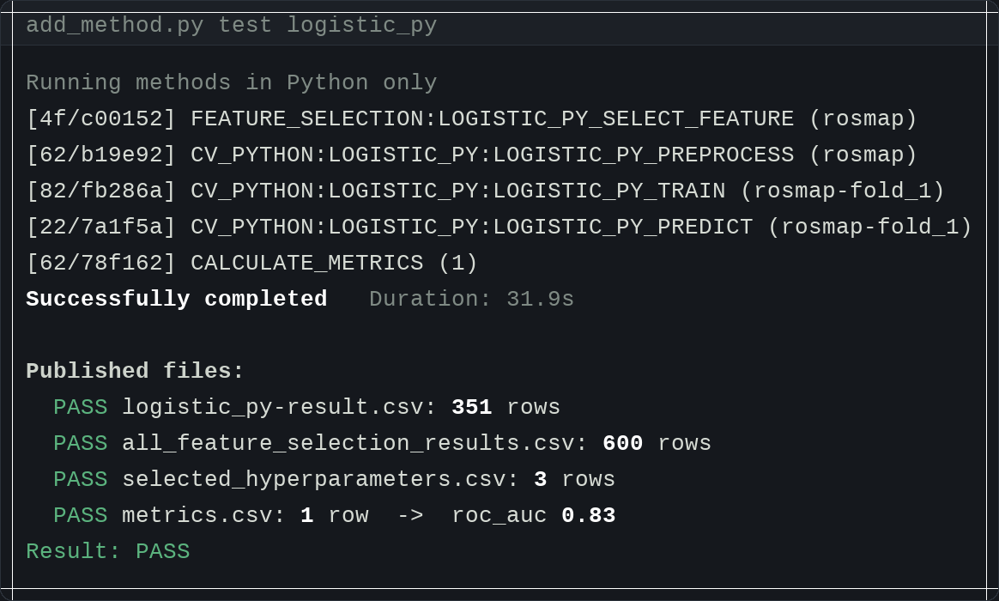

# Adding a benchmark method — worked walkthrough

The developer writes **three functions in one file**; a single command generates the
four Nextflow processes, wires the method into five files (printing every inserted
line), and validates it end to end. Below is real output on this server
(dataset `rosmap`, 2-fold CV, reusing existing images, non-root containers),
shown for both an R and a Python method.

---

## The only file you edit

Three functions — `fit`, `predict_proba`, `feature_weights` — with their input and
output shapes in the comments. Nothing else in the method is written by hand.

**R** — reuses `tonyliang19/rgcca`

**Python** — reuses `tonyliang19/eipy`

---

## 1. Generate — one question at a time

Each answer is validated; a bad name is rejected and re-asked. Python is identical
with the answers `logistic_py`, `Python`, `eipy`.

## 2. Preview — every inserted line, before writing

The exact change is shown, not just the filenames. `--dry-run` stops here.

## 3. Check — your functions in the container, non-root

Runs the three functions on synthetic data through the real validators, inside the
image, as a non-root user.

**R**

**Python**

## 4. Test — the real pipeline on rosmap

Only this method runs. Same result in both languages: 351 result rows, 600 selected
features, roc_auc 0.83.

**R**

**Python**

---

*Figures are rendered terminal output; the copy-pasteable text of every block is in
`add_method_examples.md`. The DIABLO regression on `rosmap` is byte-identical between
`dev` and this branch (all four output files `SAME`), so existing methods are unaffected.*
